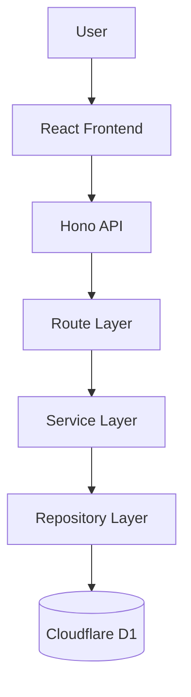

# Duesly — Shared Bill Splitter

Duesly is an application for managing shared household bills.

People living in the same home can add members, create bills, split the amount between members, and track who has paid.

The goal is simple: split bills correctly and make it clear how much each member still owes.

## What it does

- **Homes:** Create and switch between different households.
- **Members:** Add members to a household and manage their membership.
- **Bills:** Create a bill and automatically split the amount between active members.
- **Payments:** Mark individual shares as paid.
- **Balances:** See how much each member still owes across all bills.
- **History:** Keep previous bills and payment records when a member leaves a household.

## Stack

- **API:** Hono on Cloudflare Workers
- **Database:** Cloudflare D1 (SQLite)
- **Web:** React, Vite, TanStack Router
- **Language:** TypeScript on both sides
- **Tests:** Vitest running inside the Workers runtime
- **Quality:** Biome

## How it works

The application has three main backend layers.

- **Routes:** Receive HTTP requests, validate input, and return responses.
- **Services:** Handle the application rules, such as splitting bills and recording payments.
- **Repositories:** Read and write data in the database.

The frontend communicates with the API using HTTP requests.

### Architecture



### Data flow

When a user creates a bill:

1. The frontend sends the bill title and total amount to the API.
2. The API checks that the household exists and has active members.
3. The service calculates each member's share.
4. The repository stores the bill and its shares in D1.
5. The API returns the created bill and shares.
6. The frontend refreshes the household data.

When a member pays a share, the API records the payment and updates the share's payment status.

## Important rules

### 1. Money calculations

All amounts are stored as integer cents. The application does not use floating-point numbers for money calculations.

For example, splitting 1,000 cents between three members gives:

| Member | Share |
|---|---:|
| Member 1 | 334 cents |
| Member 2 | 333 cents |
| Member 3 | 333 cents |
| **Total** | **1,000 cents** |

The extra cents go to the members in the order they were added.

Zero-cent shares are also supported when a small bill is split between many members.

### 2. Payments

Every payment request requires an `Idempotency-Key`.

- Sending the same key again for the same share returns the original payment result.
- Sending a different key for an already-paid share returns a conflict.
- Database constraints protect against duplicate payment records.
- Concurrent requests cannot successfully pay the same share twice.

If a request fails or its outcome is uncertain, the frontend refreshes the household data before showing the payment as complete.

This application records payments. It does not connect to an external payment gateway.

### 3. Member history

A member can leave a household.

Departed members are not included in new bill splits, but their previous bills, shares, and payments remain available.

Member order is preserved and is used when distributing remainder cents.

### 4. Database constraints

The migrations define named database constraints to protect data integrity. Three examples are:

- **`chk_shares_amount_nonnegative` — CHECK:** Prevents a share amount from being negative.
- **`fk_shares_bill_home` — FOREIGN KEY:** Ensures a share references a bill and household combination that exists.
- **`uq_payments_idempotency` — UNIQUE:** Prevents the same idempotency key from being stored on multiple payment records.

The database also defines **`uq_members_home_normalized_name`**, a unique expression index on `home_id` and `lower(trim(name))`. It prevents duplicate member names within the same household after trimming surrounding whitespace and converting the comparison to lowercase.

These definitions are in `api/migrations/0002_allow_zero_value_shares.sql` and `api/migrations/0003_unique_member_name_per_home.sql`.

## API endpoints

| Method | Endpoint | Purpose |
|---|---|---|
| GET | `/api/homes` | List households |
| POST | `/api/homes` | Create a household |
| POST | `/api/homes/:homeId/members` | Add a member |
| POST | `/api/homes/:homeId/bills` | Create and split a bill |
| POST | `/api/bills/:billId/shares/:shareId/pay` | Pay a share |
| GET | `/api/homes/:homeId/balances` | Get household balances |

All error responses use JSON:

```json
{
  "error": "Error message"
}
```

## Project structure

```text
.
├── api/
│   ├── migrations/
│   ├── src/
│   │   ├── middleware/
│   │   ├── repositories/
│   │   ├── routes/
│   │   ├── services/
│   │   ├── types/
│   │   ├── utils/
│   │   └── validators/
│   └── test/
│
├── web/
│   └── src/
│       ├── api/
│       ├── components/
│       ├── hooks/
│       ├── routes/
│       ├── types/
│       └── utils/
│
└── package.json
```

## Run it

This is a pnpm workspace. Install dependencies from the project root.

### Requirements

- Node.js
- Corepack
- pnpm through Corepack

### Installation

```bash
git clone https://github.com/Saxteja/shared-bill-splitter.git
cd shared-bill-splitter
corepack pnpm install
```

### Start the application

```bash
corepack pnpm dev
```

This starts:

- API on `http://127.0.0.1:8787`
- Web application on `http://localhost:5173`

The API applies local database migrations before starting.

Open the web application and select a household. The Split Ledger page uses a household ID in the URL:

```text
http://localhost:5173/split?homeId=<HOUSEHOLD_ID>
```

### Other commands

```bash
corepack pnpm test
corepack pnpm check
corepack pnpm typecheck
corepack pnpm build
```

- `test` runs the API tests.
- `check` runs Biome checks.
- `typecheck` checks TypeScript in the workspace.
- `build` creates the production frontend build.

## Cases handled

The application handles:

1. A household with no members.
2. Zero, negative, and invalid bill amounts.
3. Bill amounts that do not divide evenly.
4. The same payment request sent more than once.
5. Two requests attempting to pay the same share.
6. A bill, share, or household that does not exist.
7. API errors and slow responses.
8. Members leaving a household while keeping their history.
9. Duplicate member names within the same household.
10. Failed or uncertain payment requests.

## Tests

The API tests cover household creation, member management, bill splitting, payments, balances, and error handling.

Additional tests cover:

- Uneven and zero-cent splits.
- Payment retries and idempotency.
- Concurrent payment requests.
- Household data isolation.
- Departed member history.
- Duplicate member names.
- Invalid requests and database rollback.

The frontend was also checked manually for household switching, bill creation, payments, persistence, loading states, API failures, and slow network responses.

## Decisions

### 1. Use integer cents for money

I chose integer cents instead of floating-point numbers because financial calculations should not depend on floating-point precision.

This also makes it easier to distribute remainder cents without losing or creating money.

### 2. Use idempotency keys for payments

A request can fail because of a network problem even when the server has already processed it.

I used idempotency keys so that retrying the same payment does not create another payment record.

Database constraints provide another layer of protection against duplicate payments.

### 3. Separate routes, services, and repositories

I separated HTTP handling, business logic, and database operations.

This keeps route handlers small and makes individual parts easier to test and maintain.

## AI tools

AI tools were used during development for implementation assistance, debugging, code review, and documentation.

The final implementation and its behavior were reviewed and tested. I can explain the architecture, business rules, and technical decisions made in this project.

## Submission

- **Repository:** https://github.com/Saxteja/shared-bill-splitter
- **Demo video:** To be added

The video demonstrates the architecture, data flow, important edge cases, and the engineering decisions made during development.
